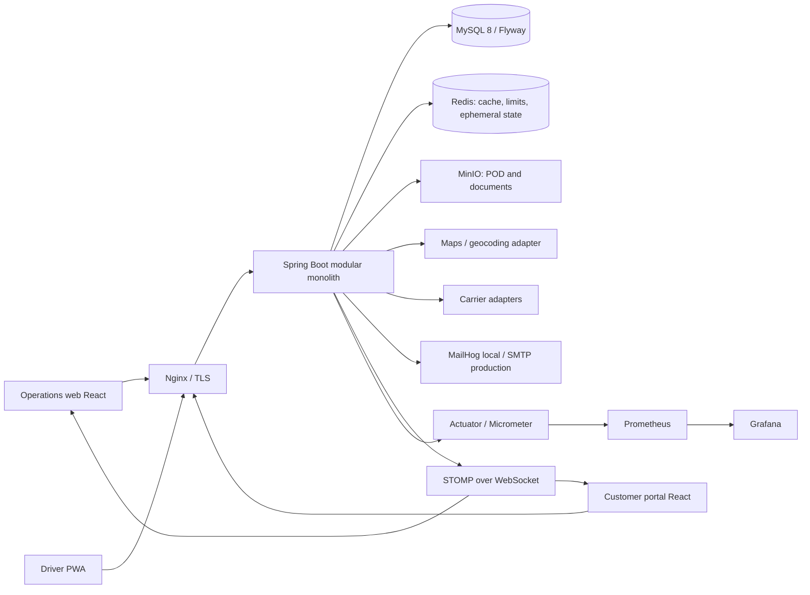

# System Architecture

**Status:** Proposed target architecture; no application implementation exists in the inspected workspace (2026-11-04).

## Goals and boundaries

Build a secure, auditable logistics control platform as a modular monolith. Keep transactions and core operational data in one MySQL 8 database initially; isolate business capabilities through package-by-feature boundaries and explicit application services/domain events. Scale by running multiple stateless application instances before considering service extraction. The platform serves internal operations, customers, and drivers through separate authorization scopes and responsive web/PWA experiences.

In scope: master data, orders/shipments, WMS, TMS, location tracking/control tower, delivery exceptions/POD, billing, notifications, analytics, customer access, administration, audit. External carriers, maps/geocoding, email, object storage, and optional payment/tax services are adapters, not trusted authorities.

## Logical view



## Backend structure

Java 21, Spring Boot 3.x, Maven, Spring Security 6, Spring Data JPA, Hibernate Spatial, MySQL 8, Flyway, Redis 7, MinIO, MapStruct, Lombok, Bean Validation, STOMP, Quartz, Actuator/Micrometer, springdoc OpenAPI. Use a package-by-feature layout with inward dependencies:

```text
com.example.logistics
  shared/                 # identifiers, clock, errors, security primitives; no domain policy
  identity/               # users, credentials, roles, permissions, refresh sessions
  partners/                # customers, suppliers, contacts, addresses
  catalog/                 # products, units, warehouses, locations
  orders/                  # order intake and lifecycle
  shipments/               # consignments, items, milestones
  inventory/                # stock ledger, reservations, adjustments
  warehouse/                # receipts, picks, packs, dispatch operations
  transport/                # vehicles, drivers, routes, trips, assignments
  tracking/                 # location ingestion, latest position, geofences
  exceptions/                # exception cases, ownership, resolution
  proof/                    # POD metadata and secure object references
  billing/                  # charges, invoices, payment records
  notifications/            # preferences, templates, outbox delivery
  analytics/                # read models and exports
  audit/                    # append-only security and business audit records
  integrations/             # ports and provider-specific adapters
```

Each feature owns `api` (controllers/DTOs), `application` (use cases), `domain` (rules/events), and `infrastructure` (JPA/adapters) packages. Cross-feature calls go through application-facing interfaces; publish immutable domain events after committed state changes using a transactional outbox. Do not share JPA entities across feature boundaries. Controllers validate and map DTOs; services enforce authorization and invariants; repositories remain feature-owned. MapStruct handles DTO mapping. Use UTC `Instant`, UUID public identifiers, `BigDecimal` for money and precision-sensitive quantities, and `@Version` for contested mutable records. Internal database keys may be numeric or UUID but must never leak as API identifiers.

## Frontend structure

React 18, TypeScript strict, Vite, React Router 6, TanStack Query for server state, Zustand only for transient cross-page UI state, Ant Design 5, React Hook Form + Zod, Axios, i18next, Leaflet, ECharts, Dexie for explicitly bounded offline data, Workbox for PWA caching, Vitest/RTL and Playwright. Suggested `src/app` (routing/providers/auth shell), `src/features/<feature>/{api,components,pages,schemas}`, `src/shared` (API client, design primitives, i18n, permissions), `src/pwa`, and `src/locales/{en,fa}`. API responses and errors are typed from the OpenAPI contract. Enforce LTR/RTL at the document/theme layer. Cache only public shell assets and the minimum driver task data needed offline; never cache access tokens or unrestricted customer records.

## Data and consistency

MySQL is the system of record for transactional workflows. Flyway migrations are forward-only and immutable after application. Index tenant/customer scope, statuses, operational dates, foreign keys and tracking time; use InnoDB. Hibernate Spatial stores normalized coordinate points and geospatial indexes where supported by the chosen MySQL version. Keep a partition/retention strategy for high-volume tracking events; do not prematurely partition core transactional tables. Redis is non-authoritative for cache, rate-limit counters, short-lived websocket/session coordination, and idempotency coordination only when durable uniqueness is also enforced in MySQL. MinIO stores binary objects; SQL stores metadata, ownership, checksum, and object key. Use transactional outbox for event delivery; consumers are idempotent.

## Identity, authorization, and tenancy

JWT access tokens are short-lived and contain subject, issuer, audience, expiry, token ID, and minimal authorization context. Store only hashes of opaque rotating refresh tokens in a session/family record; atomically rotate on refresh, revoke a family on reuse, and support logout/revocation. Passwords use a current adaptive hash (Argon2id or BCrypt after compatibility review), generic login errors, progressive account lockout, and MFA as a later hardening decision. Backend service/API checks enforce role + permission + object scope. Tenant/customer ownership is part of every applicable query and mutation; never infer scope from client-supplied IDs alone. Audit actor, action, target, timestamp, correlation ID, and selected redacted before/after values; exclude passwords, tokens, and sensitive files.

## Interfaces and events

External API is versioned `/api/v1`; JSON DTOs, ISO-8601 UTC timestamps, UUID IDs, pagination/filter conventions, idempotency keys on retry-prone create/command endpoints, and a stable error envelope. OpenAPI is generated from controllers and reviewed as a contract. WebSocket/STOMP is a notification channel, not a source of truth; clients reconcile via authorized REST queries. Domain events are internal and versioned, written to an outbox within the same transaction. Quartz jobs must use cluster-safe acquisition/locking and idempotent handlers.

## Deployment and operations

Docker Compose supports local development with MySQL, Redis, MinIO, MailHog, API, frontend/Nginx, Prometheus, and Grafana. Production deployment topology, secrets manager, TLS termination, backups, and HA are open decisions. CI should compile/test/build images, scan dependencies/images, validate Flyway migration ordering, and publish artifacts only from trusted branches. Use health/readiness endpoints, structured JSON logs with correlation IDs, Micrometer metrics, dashboards/alerts, backup/restore drills, and documented rollback. Do not expose Actuator administration publicly. Configure secrets through environment/secret injection, never source control.

## Requirements traceability

See [REQUIREMENTS_TRACEABILITY.md](REQUIREMENTS_TRACEABILITY.md) for requirement-to-module/phase/test mapping. All items there are planned, not implemented.
