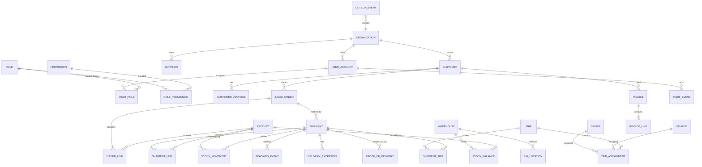

# Conceptual Data Model and ERD

**Status:** Proposed logical model, not a migration or implemented schema. Cardinality and rules require validation during each feature phase.

## Entity guidance

All externally addressable records use immutable UUID public IDs. Most tables include `created_at`, `updated_at` as UTC instants; mutable aggregate roots include integer `version`. Apply `organization_id` (tenant scope) consistently to owned business records, with foreign keys and scoped uniqueness. Soft deletion is only for selected master records; operational and financial history is retained and corrected by compensating entries.

| Area | Core records | Important relationships/rules |
|---|---|---|
| Identity | Organization, UserAccount, Role, Permission, UserRole, RolePermission, RefreshSession | Unique normalized email within organization; refresh token hash/family/revocation metadata; role grants do not bypass object scope. |
| Partners/catalog | Customer, Supplier, Address, Product, UnitOfMeasure, Warehouse, BinLocation | Customer and supplier data are organization-scoped; addresses may be typed and historized; SKU unique by organization. |
| Order/fulfillment | SalesOrder, OrderLine, Shipment, ShipmentLine | Order may spawn multiple shipments; quantities use `DECIMAL` and explicit unit; currency is ISO code; immutable snapshot of ship-to and prices where legally needed. |
| Inventory | StockBalance, StockMovement, Reservation, WarehouseTask | Movement ledger is append-only; balance is transactionally maintained/projection; unique idempotency reference prevents duplicate posting. Define lot/serial/expiry requirements before WMS schema. |
| Transport/tracking | Driver, Vehicle, Trip, TripAssignment, ShipmentTrip, TrackingEvent, LatestPosition, Geofence | Tracking events have source, observed/received instants, accuracy, coordinate SRID; latest position is rebuildable. Retention and partitioning policy required. |
| Exceptions/POD | DeliveryException, ProofOfDelivery, StoredObject | Exception records link shipment and status history; POD stores object metadata, checksum, MIME, uploader/captured time, and consent where required; binary in MinIO only. |
| Finance | Charge, Invoice, InvoiceLine, PaymentRecord | Monetary values use DECIMAL plus currency; issued invoices are immutable, corrected by credit/reissue; payment records reconcile to provider reference. |
| Platform | AuditEvent, OutboxEvent, Notification, NotificationPreference, IdempotencyRecord | Audit append-only and redacted; outbox persisted in business transaction; idempotency key unique per actor/operation and bounded retention. |

## Data integrity and indexing

Use FK constraints, check constraints for nonnegative amounts/valid ranges, unique indexes for business keys, and explicit status transition validation in services. Define decimal precision only after currencies and quantity ranges are confirmed. Add compound indexes such as `(organization_id, status, planned_delivery_at)`, `(shipment_id, observed_at)`, and `(organization_id, external_reference)`. Verify MySQL spatial index behavior for the exact deployed version. Time-series event retention, deletion/anonymization obligations, and backup RPO/RTO are unresolved; see [OPEN_QUESTIONS_AND_RISKS.md](OPEN_QUESTIONS_AND_RISKS.md).
