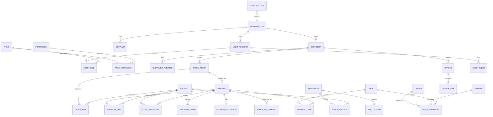

# Conceptual Data Model and ERD

**Status:** Proposed logical model, not a migration or implemented schema. Cardinality and rules require validation during each feature phase.

## Entity guidance

All externally addressable records use immutable UUID public IDs. Most tables include `created_at`, `updated_at` as UTC instants; mutable aggregate roots include integer `version`. Apply `organization_id` (tenant scope) consistently to owned business records, with foreign keys and scoped uniqueness. Soft deletion is only for selected master records; operational and financial history is retained and corrected by compensating entries.

| Area | Core records | Important relationships/rules |
|---|---|---|
| Identity | Organization, UserAccount, Role, Permission, UserRole, RolePermission, RefreshSession | Unique normalized email within organization; refresh token hash/family/revocation metadata; role grants do not bypass object scope. |
| Partners/catalog | Customer, Supplier, Address, Product, UnitOfMeasure, Warehouse, BinLocation | Customer and supplier data are organization-scoped; addresses may be typed and historized; SKU unique by organization. |
| Order/fulfillment | SalesOrder, OrderLine, Shipment, ShipmentLine | Order may spawn multiple shipments; quantities use `DECIMAL` and explicit unit; currency is ISO code; immutable snapshot of ship-to and prices where legally needed. |
| Inventory | StockBalance, StockMovement, Reservation, WarehouseTask | Movement ledger is append-only; balance is transactionally maintained/projection; unique idempotency reference prevents duplicate posting. Define lot/serial/expiry requirements before WMS schema. |
| Transport/tracking | Driver, Vehicle, Trip, TripAssignment, ShipmentTrip, TrackingEvent, LatestPosition, Geofence | Tracking events have source, observed/received instants, accuracy, coordinate SRID; latest position is rebuildable. Retention and partitioning policy required. |
| Exceptions/POD | DeliveryException, ProofOfDelivery, StoredObject | Exception records link shipment and status history; POD stores object metadata, checksum, MIME, uploader/captured time, and consent where required; binary in MinIO only. |
| Finance | Charge, Invoice, InvoiceLine, PaymentRecord | Monetary values use DECIMAL plus currency; issued invoices are immutable, corrected by credit/reissue; payment records reconcile to provider reference. |
| Platform | AuditEvent, OutboxEvent, Notification, NotificationPreference, IdempotencyRecord | Audit append-only and redacted; outbox persisted in business transaction; idempotency key unique per actor/operation and bounded retention. |

## Data integrity and indexing

Use FK constraints, check constraints for nonnegative amounts/valid ranges, unique indexes for business keys, and explicit status transition validation in services. Define decimal precision only after currencies and quantity ranges are confirmed. Add compound indexes such as `(organization_id, status, planned_delivery_at)`, `(shipment_id, observed_at)`, and `(organization_id, external_reference)`. Verify MySQL spatial index behavior for the exact deployed version. Time-series event retention, deletion/anonymization obligations, and backup RPO/RTO are unresolved; see [OPEN_QUESTIONS_AND_RISKS.md](OPEN_QUESTIONS_AND_RISKS.md).

## Minimum entity data dictionary

This is the minimum logical inventory for planning, not a physical schema. `id` means immutable public UUID; organization-owned rows also carry `organization_id`, `created_at`, and where mutable `updated_at`/`version`. Exact nullability, precision, and retention remain subject to business and legal review.

| Entity | Purpose / principal attributes | Relationships / invariants |
|---|---|---|
| Organization | Tenant boundary; name, status, locale, default currency/time zone | Owns users and operational records; scoped unique keys. |
| UserAccount | Login identity; normalized email, password hash, status, last login | Belongs to organization; never stores plaintext credentials. |
| Role / Permission | Named grant bundle and immutable permission key | M:N via UserRole and RolePermission; deny by default. |
| RefreshSession | Token hash, family, device, expiry, rotation/revocation times | Belongs to user; single-use rotation chain. |
| Customer / Supplier | Trading-party identity and external references | Organization-scoped; customer owns orders/invoices. |
| Address | Typed, normalized postal address and optional coordinates | Party-associated; order/shipment snapshots preserve history. |
| Product / UnitOfMeasure | SKU, description, unit, tracking/handling flags | SKU unique per organization; quantities carry explicit unit. |
| Warehouse / BinLocation | Facility and internal storage location | Bin belongs to warehouse; access can be warehouse-scoped. |
| SalesOrder / OrderLine | Customer request, dates, currency and commercial snapshot | Order has one or more positive-quantity lines. |
| Shipment / ShipmentLine | Fulfillment unit, lifecycle, milestones | May fulfill part of an order; destination snapshot retained. |
| StockBalance | Current quantity by warehouse/bin/product (future lot dimension) | Maintained transactionally from movements; unique dimension key. |
| StockMovement | Append-only receipt, allocation, pick, dispatch, adjustment, return | Corrections use compensating movements. |
| Reservation | Quantity held for order/shipment and release/consume state | Prevents oversell transactionally; idempotent command reference. |
| WarehouseTask | Receipt/pick/pack/count item, assignee and status | Completion posts movements once. |
| Driver / Vehicle | Driver qualification and vehicle capacity/status | Organization-scoped; assignment checks availability/eligibility. |
| Trip / TripAssignment | Planned route and dated driver/vehicle assignment | Active overlapping assignments prohibited by policy. |
| ShipmentTrip | Shipment stop/order within a trip | M:N association; sequence unique per trip. |
| TrackingEvent | Immutable coordinate, accuracy, source/device, observed/received time | Dedupe key; partition by event time. |
| LatestPosition | Rebuildable current coordinate/time by tracked subject | Projection from TrackingEvent, never authoritative history. |
| Geofence | Geometry, type, activation and notification policy | Entry/exit signals are derived and deduplicated. |
| DeliveryException | Type, severity, open/resolve times, owner and reason | Shipment-bound; lifecycle history and audit. |
| ProofOfDelivery | Capture metadata, signer/consent, checksum, validation state | References private StoredObject; replacement is a new version. |
| StoredObject | Bucket/key, size, detected MIME, checksum, scan state, retention | Private ACL; authorization checked before signed URL issuance. |
| Charge | Billable item, quantity, unit price, currency, tax classification | Source reference idempotent; finalized charge corrected by adjustment. |
| Invoice / InvoiceLine | Number, dates, currency, immutable totals and snapshots | Issued invoice immutable; credit/reissue records corrections. |
| PaymentRecord | Amount, currency, method/provider reference, received/reconciled state | Append-only; provider reference unique. |
| Notification / Preference | Recipient, template, channel, delivery state and preference | Retryable/idempotent; mandatory security notices cannot be suppressed. |
| AuditEvent | Actor, action, target, time, correlation, redacted change summary | Append-only, restricted access, retention policy required. |
| OutboxEvent | Event ID/type/schema version, aggregate, payload, publish/attempt state | Inserted with aggregate update; consumers dedupe by event ID. |
| IdempotencyRecord | Actor, operation, key, request digest, stored result and expiry | Unique actor+operation+key; digest mismatch conflicts. |
| StateTransition | Aggregate/type, from/to, actor, reason, time, command ID | Append-only history for shipment, exception, invoice, task and trip. |

### GPS retention and partitioning proposal

Keep high-volume `tracking_event` separate from transactional aggregates. Partition by UTC `received_at` in monthly RANGE partitions initially, with whole-partition expiration only after legal-hold checks. The partitioned key must include the partition column; if global deduplication is required, maintain a compact dedupe table with bounded retention. Index `(organization_id, subject_type, subject_id, observed_at)` and `(organization_id, received_at)`. Update `latest_position` only for newer observed times, using deterministic tie-breaking. Validate MySQL 8 partitioning restrictions, foreign-key limitations, pruning, write throughput, and restore behavior before DDL. Archive or aggregate older tracks if policy requires history; never discard legal-hold data.
