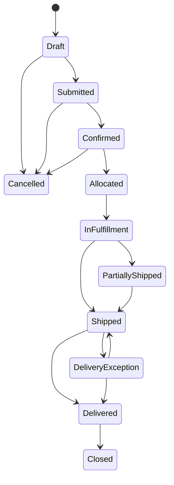

# State Machines

**Status:** Proposed initial lifecycle; business owners must validate names, transitions, and cancellation rules before implementation. Every transition is an authorized command, audited and concurrency checked.

## Candidate lifecycles

| Aggregate | States and notes |
|---|---|
| Order | Draft → Submitted → Confirmed → Allocated → In fulfillment → Partially shipped/Shipped → Closed. Cancel is permitted only before irreversible fulfillment; post-confirmation correction policy is open. |
| Shipment | Planned → Ready → Dispatched → In transit → Delivered, with Delivery exception and Return in progress branches. Delivery may require POD policy. A delivered shipment is not silently reverted. |
| Warehouse task | Queued → Assigned → In progress → Completed; Assigned/In progress may be Blocked or Cancelled with reason. Inventory posting must be idempotent. |
| Trip | Planned → Assigned → Ready → In progress → Completed; may be Cancelled before start or Interrupted with reason. Assignment changes are audited. |
| Exception | Open → Acknowledged → In resolution → Resolved; may be Reopened with a reason. Resolution captures code, actor, time, and evidence. |
| POD | Awaiting capture → Uploaded → Validated → Accepted/Rejected. Rejected evidence remains auditable; replacement creates a new version. |
| Invoice | Draft → Approved → Issued → Partially paid/Paid or Overdue; Void/Credit only under an authorized financial correction policy. Issued snapshots are immutable. |
| Refresh session family | Active → Rotated; reuse detection → Revoked. Expiry and logout revoke. Rotation is atomic. |

Guard transitions by permission, tenant/object scope, current state/version, required fields, and preconditions. Emit events only after a successful transaction. Persist a transition history for business-critical aggregates (at minimum shipment, exception, invoice); never rely on client-side state alone.
